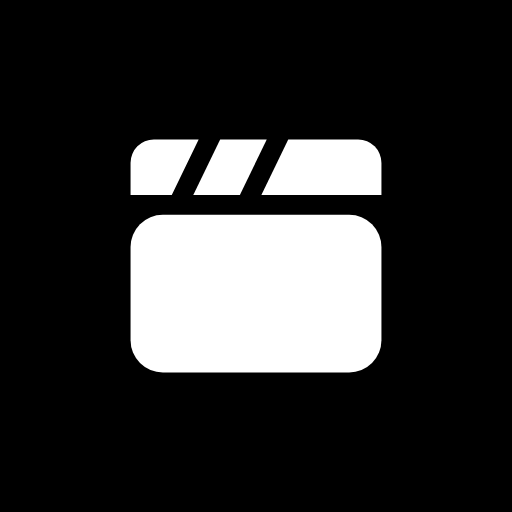

##  Multi Media Studio

Videolarınızı çok kanallı bir zaman çizelgesiyle doğrudan tarayıcınızda düzenleyin.

Multi Media Studio, kliplerinizi kesmenizi, katmanlamanızı, renklendirmenizi, başlık ve müzik eklemenizi, ardından MP4 veya WebM olarak dışa aktarmanızı sağlayan açık kaynaklı bir video düzenleyicidir. Telefonda mobil video düzenleyicilerine benzeyen bir yerleşim, masaüstünde ise tam bir çalışma alanı sunar.

Tüm işlemler tarayıcınızda yerel olarak gerçekleşir. Medyanız hiçbir sunucuya yüklenmez. Projeler yalnızca bu tarayıcıda, bu cihazda saklanır.

🌐 **Canlı Demo Bağlantısı :** https://aligokdam.github.io/multi.media.studio/

---

## Özellikler

- 🎞️ Video, fotoğraf, metin, müzik ve ses efektleri için çok kanallı zaman çizelgesi
- ➕ Kanal ekleme, yeniden adlandırma ve silme (üst üste birden fazla müzik kanalı dahil)
- ✂️ Klipleri bölme, kırpma, birleştirme, çoğaltma ve yeniden sıralama
- 🔎 Her kütüphanede arama, kategori ve filtreler, İçeri Aktar düğmesi ve sürükle bırak
- 🎨 14 renk filtresi ve ayarlanabilir GPU efektleri: Cutout, Posterize, Eşik, Piksel, Glitch, RGB Kayması, Halftone, Eski Baskı, Kenar ve Kontur, Kabartma ve daha fazlası (fotoğraf ve videoda aynı kod), kendi `.mmsfx` efektleriniz
- 🔀 4 kategoride 22 geçiş ve GL Transitions `.glsl` dosyalarını içeri aktarma
- 🚫 Efekt veya geçiş istemeyenler için tek dokunuşla "Yok" seçeneği
- 🔤 Başlıklar ve altyazılar, 18 metin geçişi (otomatik geçiş isteğe bağlı, varsayılan olarak kapalı)
- 🅰️ 16 açık lisanslı yazı tipi ve kendi TTF, OTF, WOFF, WOFF2 yazı tiplerinizi içeri aktarma
- 😀 9 hazır emoji çıkartma (CC0, bu uygulama için çizildi) ve PNG, JPG, WebP, GIF, SVG ile kendi çıkartmalarınız
- 🎵 Yerleşik telifsiz müzik ve 15 kategoride 145 farklı ses efekti (CC0, cihazda üretilir)
- 🎧 MP3, WAV, M4A, AAC, OGG, Opus, FLAC, AIFF ve WebM ses desteği (tarayıcının çözebildiği ölçüde)
- ⏩ Hız, ses seviyesi ve geçişler
- ↩️ Geri al ve yinele
- 💾 8K'ya kadar, 24 ile 60 fps arası MP4 ve WebM dışa aktarma (cihazın kodlayıcısı destekliyorsa)
- 🖼️ Fotoğraf düzenleyici: tek fotoğraf ya da en fazla 9 fotoğraflı kolaj, 14 filtre, efektler, ayarlar, metin ve çıkartma, 8K'ya kadar JPG, PNG, WebP
- 📦 Proje dışa ve içeri aktarma (.mmsp)
- 📱 Telefona özel yerleşim, açık ve koyu tema
- 🌍 Sağdan sola desteğiyle 24 dil
- 🔒 Tamamen istemci tarafında işleme

---

## Nasıl Çalışır

1. Oluştur'a basıp fotoğraf ya da video seçin. Fotoğraflar fotoğraf düzenleyicide, videolar video düzenleyicide açılır.
2. Video, fotoğraf ve ses ekleyin.
3. Zaman çizelgesinde düzenleyin: kesin, başlık, geçiş, efekt ve renk ekleyin.
4. Videonuzu MP4 veya WebM olarak dışa aktarın.

---

## Proje Yapısı

Klasör ve kütüphane adları İngilizcedir. Her klasörde ne işe yaradığını anlatan İngilizce bir `README.md` bulunur.

```text
multi.media.studio/
├── index.html              ana sayfa, gizlilik ve koşullar (uygulamanın giriş noktası)
├── README.md               bu dosya
├── LICENSE                 MIT lisansı
├── app.webmanifest         uygulama kimliği: ad, simge, renk (ana ekrana ekleme)
├── sw.js                   çevrimdışı önbellek (kapsam için kök dizinde olmalı)
├── assets/
│   ├── css/                base, landing, studio, photo-editor stilleri
│   ├── icons/              uygulama simgeleri (SVG ve PNG)
│   └── fonts/              16 açık lisanslı yazı tipi ve lisans metinleri
├── src/
│   ├── main.js, boot.js, config.js
│   ├── core/               ortak yardımcılar, dil, ayarlar, simgeler, tema
│   ├── landing/            ana sayfa davranışı
│   ├── studio/             proje listesi, video düzenleyici, zaman çizelgesi, denetçi
│   ├── photo-editor/       fotoğraf düzenleyici ve kolaj
│   ├── media/              dosya içeri aktarma ve doğrulama
│   ├── render/             WebGL2 birleştirici, efektler, filtreler, geçişler, metin, yazı tipleri, çıkartmalar
│   ├── audio/              müzik ve ses efektlerini üreten sentezleyici
│   ├── export/             MP4 ve WebM dışa aktarma
│   ├── storage/            yerel depolama ve .mmsp paketleri
│   └── workers/            dalga biçimi ve zaman esnetme işçileri
├── components/             ortak arayüz bileşenleri (sayfa, bildirim, kontroller)
│   └── panels/             medya, müzik, ses, metin, efekt, geçiş ve çıkartma kütüphaneleri
├── locales/                24 dil (tek yerelleştirme sistemi)
├── audio/                  yerleşik müzik ve ses kütüphanesi rehberi (sesler cihazda üretilir)
├── libraries/              mediabunny (MPL-2.0), fflate (MIT)
├── examples/               örnek efekt ve geçiş dosyaları
└── scripts/                dil denetleyici, tek dosya derleme
```

Yerel olarak çalıştırmak için klasörü herhangi bir statik sunucuyla sunun (örneğin `python3 -m http.server`).
`python3 scripts/build-single.py` uygulamanın tamamını `dist/` içinde tek bir HTML dosyası olarak derler.

---

## Lisans

MIT Lisansı

Yerleşik müzik ve sesler CC0 1.0. Yazı tipleri SIL Open Font License 1.1 (Permanent Marker için Apache 2.0) altındadır, lisans metinleri `assets/fonts/licenses` klasöründedir.

---

**Ali Gökdam** tarafından oluşturuldu
